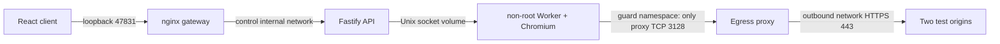

# Архитектура Slice 0–1

Slice 3 extends only the dedicated session deployment with Worker-owned two-member identity/invites/control leases and Broker membership-gated LiveKit signaling. See [shared room protocol, lifecycle and acceptance](SLICE-3-SHARED-BROWSER-REPORT.md). The existing Chromium/capture/publisher pipeline remains one per session; no Core services participate.

Slice2B.2 adds a dedicated session deployment without changing this original topology. See [unified BrowserSession ownership, lifecycle and acceptance](SLICE-2B2-SESSION-INTEGRATION-REPORT.md). Its Worker owns one headful Chromium/private Xvfb/FFmpeg per BrowserSession; commands, PNG and live pixels use that same context. Session/owner/epoch-bound broker authorization and server-side room deletion connect it to the publisher and unified React client.

Подробный утверждённый контракт: [SLICE-0-1-SPEC.md](SLICE-0-1-SPEC.md). npm workspaces, единый lockfile, TypeScript strict. Shared DTO и runtime schemas в packages/protocol. Продуктовый API не предоставляет eval, CDP, selectors или имена Playwright methods.

Bootstrap DAG: proxy starts independently; guard applies firewall then becomes healthy; worker shares guard namespace and waits for health; API starts after worker; gateway starts after API. No circular dependency. Socket readiness checked through /ready; Compose startup order alone does not promise application readiness.

Gateway additionally joins its own edge bridge for Docker Desktop loopback port publication: an internal-only bridge did not publish the requested port on this runtime. Only gateway joins edge; API remains control-only, worker remains guard-only. No browser route to edge exists.

Worker creates a fresh Chromium process and nonpersistent context per session. Commands and screenshots share a bounded sequential executor (16 outstanding); crash/TTL cleanup can interrupt it. Browser-close deadline exits worker on a stuck close; container init reaps descendants. One session in memory, latest terminal metadata retained until next create. API restart does not persist auth/session state; worker continues enforcing TTL. Idle 5 min, absolute 20 min; frame/status reads do not extend idle.

External gateway routes `/api/*` to API without prefix. `/health` liveness; `/ready` verifies worker, firewall marker and proxy. All `/sessions*` require bearer token; fixed owner local-owner. API rate cap 30 requests/sec for the single local owner. Worker validates schemas without coercion or stripping unknown fields. Max body 16 KiB; navigation timeout 12 sec, screenshot 8 sec. POST create returns 201; DELETE 204; other successful commands return session DTO. Error shape `{error:{code,message}}`; no logs of request bodies.

Viewport 1280×720 CSS px, DPR 1, PNG viewport only, zoom 100%. Display has preserved aspect ratio; pointer coordinates use actual img bounding rect, scaled to viewport. Text insertion is explicit, keyPress has a finite editing/navigation allowlist. Mouse API accepts move/click, wheel accepts bounded deltas. No drag/keyDown/keyUp protocol in this slice. No screenshot polling loop.

Resource settings are initial ceilings, not capacity claims: worker 2 CPUs/768 MiB/256 PIDs, 512 MiB tmpfs and 256 MiB shm; proxy/API 128 MiB; client 64 MiB; guard 32 MiB. Actual observations and security acceptance are in the report.

