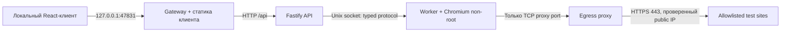

# Zvonok Browser Service — спецификация Slice 0–1

Статус: НА УТВЕРЖДЕНИЕ. Дата: 2026-10-20. Реализация не начата.

## Цель и границы

Самостоятельный Linux Docker Compose PoC в C:\project\zvonok-browser: один владелец создаёт настоящий серверный Chromium, посещает разрешённые публичные страницы, управляет ими через React и уничтожает сессию. Только Slice 0 и Slice 1. Основные проекты Zvonok, их сети, credentials, volumes и LiveKit не меняются.

Node.js 24 LTS, TypeScript strict, Fastify, Playwright/Chromium, React/Vite, Vitest. npm workspaces и один lockfile: дополнительный package manager не нужен. Структура: apps/api, apps/worker, apps/client, packages/protocol; infra для gateway, egress и сетевых правил; docs для четырёх запрошенных документов. Без БД, Redis, Kubernetes, multi-user и media pipeline.

## Архитектура и Docker topology

Compose project name: zvonok-browser-poc. Единственный опубликованный порт: 127.0.0.1:47831, настраиваемый при конфликте. Никаких host network, host IPC, Docker socket, общих сетей с Zvonok и mounts исходников/домашнего каталога.

- control (internal): только gateway и API. Worker и egress к ней не подключены.
- browser-egress (internal): network-guard namespace worker и внутренний интерфейс proxy. API/gateway здесь отсутствуют.
- outbound: только внешний интерфейс proxy; worker к нему не подключён.
- API и worker разделяют отдельный ephemeral volume только для Unix socket, с ограниченными UID/GID/permissions; файлов профиля браузера там нет. Сетевого control listener у worker нет.
- network-guard — небольшой отдельный init/sidecar с NET_ADMIN только в выделенном namespace браузера. Ставит default-deny IPv4/IPv6 OUTPUT, разрешает только фиксированный IP:port proxy и необходимые established responses; без DNS/UDP/QUIC/прочего TCP. Worker использует этот namespace и стартует только после успешной проверки правил. Guard не получает control socket или секреты. Его полномочия не выдаются worker.
- Proxy имеет IP forwarding выключенным; worker не может использовать его как произвольный router. Падение proxy/guard или отсутствие готовых правил запрещает запуск/продолжение браузерной сессии; отказ сети не вызывает прямой fallback.

Правила проверяются реальными отрицательными пробами из namespace worker. Internal Docker network сама по себе не считается защитой от SSRF. При невозможности подтвердить firewall/sandbox на Docker Desktop приёмка security FAIL; запреты не ослабляются.

## Security invariants

1. Chromium и worker запускаются non-root, без --no-sandbox, с chromiumSandbox: true. Worker: cap_drop ALL, no-new-privileges, read-only rootfs, ограниченные tmpfs, init/reaping дочерних процессов. Seccomp допускает только необходимые sandbox syscalls; unconfined/privileged запрещены. Проверить фактический UID, аргументы, sandbox и ограничения реальным запуском.
2. Сетевая политика fail-closed не зависит от Chromium proxy flags или Playwright interception. Прямой IP, localhost, gateway/host.docker.internal, control API, Zvonok services, metadata, RFC1918, link-local, multicast, reserved и IPv6-equivalent назначения недоступны. Допустимый proxy — единственное исходящее назначение namespace.
3. Proxy принимает только CONNECT к точным allowlisted DNS names на 443; никаких произвольных HTTP targets, IP literals, userinfo, иных портов или wildcard suffix matching. Сам разрешает DNS, проверяет все A/AAAA, отклоняет смешанные public/private ответы, соединяется с проверенным IP без повторного DNS lookup; проверяет каждый новый tunnel. IPv4-mapped IPv6 также проверяется. Клиентский DNS не используется для доступа к сайтам.
4. Стартовая allowlist: example.com и www.selenium.dev, включая только явно проверенные необходимые имена ресурсов. Расширение — изменение конфигурации с проверкой. Redirect на новый host требует нового разрешённого tunnel. HTTPS redirect внутри tunnel дополнительно проверяется Playwright. Произвольные redirect/subresources за пределами allowlist не получают сеть.
5. TLS CONNECT не расшифровывается: proxy ограничивает назначение, а не URL path или содержимое HTTPS. Playwright дополнительно проверяет URL навигаций, redirects и subresources, блокирует WebSocket и service workers, permissions, downloads, popups и опасные URI schemes. WSS на посторонний host блокируется proxy; WS, WebRTC, UDP/QUIC и иные обходы блокируются сетевыми правилами. Tunnel к разрешённому host не означает доверия содержимому сайта; это ограничение доверенных тестовых origin для PoC.
6. Нет camera/mic/geolocation, автоматического clipboard, host filesystem или секретов Zvonok. Не использовать ignoreHTTPSErrors. Ошибки возвращаются без чувствительных payload.
7. Dev bearer token создаётся локально, ownerId задан сервером. JSON ownerId не принимается. Все session routes, включая кадры и чтение состояния, требуют auth. Health не содержит секретов. Токен вводится пользователем, хранится только в памяти клиента; не в URL, localStorage или bundle. Worker не получает dev token.
8. Gateway проверяет Host, Origin и same-origin запросы; CORS наружу выключен. Доступ только loopback. Это dev-auth, не production security или готовая интеграция Zvonok.
9. Логи содержат action type, session ID, status, timings и error code; без Authorization, cookies, credentials, URL query/fragment и содержимого форм. Access/body logging отключён или редактирован.

## API contract

Внешний prefix /api; ниже пути Fastify без prefix. Общие DTO — discriminated unions + runtime JSON Schema с additionalProperties: false. Никаких eval, произвольных selectors, Playwright/CDP method names, скриптов или загрузки файлов.

- GET /health: 200 {status: "ok"}; liveness API.
- GET /ready: 200 ready либо 503; worker, network guard и egress доступны, сервис не завершается. Занятая единственная сессия не означает not ready.
- POST /sessions: пустой JSON; 201 BrowserSession. Вторая живая/создаваемая сессия: 409 SESSION_LIMIT.
- GET /sessions/:id: BrowserSession.
- POST /sessions/:id/navigate: {url: string}, только HTTPS, длина до 2048; 200 BrowserSession после завершения/ошибки навигации.
- POST /sessions/:id/back, /forward, /reload: пустой JSON; 200 BrowserSession. Отсутствие истории — успешный no-op.
- POST /sessions/:id/input: одно действие; 200 BrowserSession.
- GET /sessions/:id/frame: один PNG, Cache-Control: no-store; получение сериализовано с командами, не продлевает idle timeout.
- DELETE /sessions/:id: 204 после cleanup; повторное удаление известной завершённой сессии — 204.

Input: {type: "mouseMove", x, y}, {type: "mouseClick", x, y, button: "left"|"middle"|"right"}, {type: "wheel", x, y, deltaX, deltaY}, {type: "keyPress", key}, {type: "text", text}. Координаты конечные и в viewport; wheel delta ограничен ±2000 CSS px, text до 1000 символов, key только из документированного списка навигационных/редактирующих клавиш и безопасных сочетаний. Payload до 16 KiB; ограничение частоты управления и длины очереди с 429. Hover/move coalescing только в клиенте; переполнение не накапливает бесконечную очередь.

BrowserSession: sessionId, ownerId (из auth), status (creating|active|closing|closed|crashed|expired), createdAt, lastActivityAt, currentUrl, workerId, expiresAt, idleExpiresAt. UTC ISO timestamps. Ответы ошибок: {error: {code, message}}, без stack/body/секретов. 400 invalid action, 401 auth, 404 unknown session, 409 lifecycle/limit, 429 overload, 502 browser failure, 503 dependencies unavailable. Метаданные одной последней terminal session хранятся в памяти до следующего создания; после рестарта старые ID — 404.

## Геометрия и test client

Фиксировано: viewport 1280×720 CSS pixels, deviceScaleFactor/DPR = 1. PNG кадр 1280×720 физических pixels, viewport-only без fullPage. UI сохраняет aspect ratio, без crop/object-fit letterboxing: rect берётся с самого img. x = floor((clientX - rect.left) * 1280 / rect.width), y аналогично *720/rect.height; события вне изображения отклоняются. Координаты проверяются сервером. При scroll используются CSS px; browser zoom фиксирован 100%.

Адрес, create/delete, back/forward/reload, status, ошибки и фокусируемое изображение. Снимок вручную и после команды; нет постоянного polling кадров и fake video player. Текстовые формы управляются кликом и text/keyPress. Ctrl/Meta shortcuts перехватываются только при фокусе области браузера. Это диагностический снимок, поэтому анимации и изменения между снимками не видны; пользователь явно видит этот статус.

## Lifecycle и ресурсы

Worker — авторитетный владелец lifecycle; один глобальный последовательный executor, включая create/delete/frame. Резервирование слота до async launch. Создание запускает отдельный Chromium и non-persistent context; при уничтожении закрываются context и весь browser process tree. Cookies/localStorage/sessionStorage не переиспользуются. Профиль и downloads только ephemeral tmpfs.

Начальные продуктовые таймауты: idle 5 минут (только принятые команды владельца продлевают), absolute TTL 20 минут; навигация/команда не может бессрочно удерживать cleanup. Watchdog expiry/shutdown имеет приоритет над очередью. Page crash/browser disconnect переводят в crashed и запускают cleanup. SIGTERM/SIGINT: прекратить новые операции, отменить/ограничить текущую, закрыть Chromium и socket, завершить API; deadline с kill/reaping. При смерти worker контейнер init убирает дочерние процессы, API инвалидирует сессию. Потеря связи с API не отменяет независимый TTL worker.

CPU/RAM/PID/tmpfs/shm/deadlines — явные конфигурационные ceilings, не обещание вместимости. Конкретные стартовые ceilings выбрать при реализации, затем проверить cold start/navigation/input/delete через docker stats и process counts; отчёт сохраняет фактические значения, пики и условия. OOM/PID limit должен приводить к отказу/cleanup, не к зависшей active session. Если измерения недоступны — NOT RUN, без заявления о подобранных лимитах.

## Приёмка и отчёт

Компактная проверка: Compose поднимает gateway/client, API, worker, network-guard и egress; health/ready; создание одной сессии и отказ второй; публичная разрешённая страница; URL/back/forward/reload; click/scroll/text; DELETE и отсутствие Chromium children; чистые cookies/localStorage/sessionStorage в новой сессии; crash/TTL cleanup; отказ неавторизованным действиям; запрет опасных URL, redirect, subresources и прямого egress, включая доступ к API; подтверждение UID/sandbox/firewall; TypeScript build и целевые Vitest tests. Все пункты получают PASS/FAIL/NOT RUN с доказательствами, без подмены unit mocks настоящим Chromium.

Документы реализации: ARCHITECTURE.md, SECURITY-BOUNDARIES.md, MEDIA-TRANSPORT-ADR.md, SLICE-0-1-REPORT.md; README с PowerShell и .env.example без секретов. Отчёт: контейнеры/порты, команды, версии, измерения CPU/RAM, проверки и ограничения.

Slice 2 ADR сравнит A: viewport frames + изолированный audio → LiveKit RTC Node SDK и B: Linux display/audio → FFmpeg/GStreamer → LiveKit Ingress. Ни один путь пока не подтверждён. План измерения: 720p/1080p × 15/30 FPS, software encode на Linux VPS без GPU, CPU/RAM, input-to-pixel latency, encode/transcode stages, per-session audio isolation и ограничения Docker Desktop. В Slice 1 transport/audio не реализуются.

## Диагностика Docker и открытые риски

2026-10-20, только read-only: в sandbox недоступны ~/.docker/config.json, contexts и pipe; docker context show выдаёт default при недоступной конфигурации. Вне sandbox docker context ls/version подтверждают активный desktop-linux, работающий Docker Desktop 4.47.0 и Linux Engine 28.4.0 linux/amd64. Процессы Docker Desktop/com.docker.backend работают. com.docker.service stopped/manual при этом не мешает доступу к daemon. Host user состоит в docker-users, sandbox token — CodexSandboxUsers. Ничего не сбрасывалось, права и context не менялись. Дальнейшие Docker-команды требуют разрешённого исполнения вне sandbox, а не изменения системных ACL.

Риски до запуска: доступность Chromium user namespaces под seccomp/Docker Desktop; эффективность firewall для IPv4/IPv6 и Docker DNS; совместимость trusted sites с узкой allowlist; корректное убийство process tree; cold-start resource peaks. Сетевые и sandbox проверки — блокирующие критерии безопасного PoC. Chromium exploit/container escape не исключены контейнеризацией; только доверенные тестовые сайты, без production использования и credentials.

Утверждение этой спецификации фиксирует дизайн и разрешает непосредственно реализацию Slice 0–1 без повторного brainstorming. Пользователь запросил этот порядок; дополнительное согласование плана не требуется.
