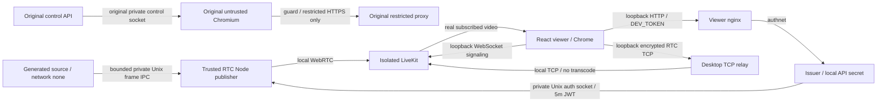

# Slice 2A — Live Media Pipeline Spike

Date: 2026-10-20. Status: **local 720p15 completion criterion verified**, including recovery and Slice 0–1 regression. Sustained 1080p30: FAIL at current limits; capture/VPS/Ingress: NOT RUN. Scope: generated video only; no Slice 2B, audio, shared control or Core integration.

## Existing invariants and scope

Read ARCHITECTURE.md, SECURITY-BOUNDARIES.md, MEDIA-TRANSPORT-ADR.md, SLICE-0-1-REPORT.md, base Compose, API/Worker/DTO, guard and proxy before changes. Preserved: Chromium UID 1000 and actual namespace/seccomp sandbox; no --no-sandbox; IPv4/IPv6 default-deny OUTPUT, only proxy 172.30.81.2 TCP/3128; exact public CONNECT allowlist; private control socket; control-only API; one BrowserSession; read-only rootfs, cap_drop ALL and CPU/RAM/PID limits. The previously documented same-UID compromised-browser limitation is unchanged.

Changes reach the React viewer/caller, client dependency/lockfile, standalone media dependency/lockfile, separate Compose/Dockerfile/config template, four media processes, acceptance/resource scripts, README and this report. Worker, protocol, API, guard, proxy and base Compose are unchanged. No Core repository or production credentials were touched. Existing networks/volumes were not deleted, reconfigured or shared with media; original services were started/restarted for regression using their normal socket/readiness volumes. The historical capture/publication candidates in Slice 1's ADR remain useful, but its proposed experiment order is superseded here for **generated publication only**. Capture selection remains OPEN.

## Actual media architecture

Independent Compose project `zvonok-browser-media`: six containers, new networks `media` (internal), `authnet` (internal), `rtc-edge`, `edge`; new volumes `auth`, `frames` store sockets only. No network membership or mount connects this project to Worker/control or Core Zvonok. Original PNG client remains at 47831; same React source serves media mode at 47832, with a link between separate modes.

| Service | Actual network and mounts | CPU / RAM / PID limits |
|---|---|---|
| generator | network none; frames volume only | 2 / 512 MiB / 128 |
| publisher | trusted LiveKit network namespace; frames + auth volumes; no API-key file | 2 / 512 MiB / 128 |
| livekit | media + rtc-edge; local test config/key read-only | 2 / 512 MiB / 128 |
| rtc-relay | trusted LiveKit namespace; no volumes or credentials | 0.25 / 64 MiB / 32 |
| broker | authnet; auth volume, local test key read-only | 2 / 128 MiB / 128 |
| viewer nginx | authnet + edge; nginx config read-only, /tmp tmpfs | 2 / 128 MiB / 128 |

All new containers use non-root processes, cap_drop ALL, no-new-privileges, read-only rootfs and init. Host listeners: **127.0.0.1 only**, viewer 47832, signaling 47833→7880, RTC TCP 47834→47836. No UDP host publication. LiveKit internally listens on RTC TCP 47834 and UDP mux 47835; publisher shares that trusted namespace.

Docker Desktop observation: internal-only bridges did not produce host bindings, so LiveKit needs its own rtc-edge bridge. After matching advertised TCP ports, direct host loopback ICE still sent STUN requests without responses; a UDP-mux probe also failed. A controlled TCP hop changed ICE to connected and media bytes advanced. The retained `rtc-relay` listens on 47836 and pipes encrypted bytes to 127.0.0.1:47834 with backpressure, 16-connection ceiling and inactivity timeout; **no transcoding**. Diagnostic Chrome flags/permission changes did not fix direct ICE and are absent from acceptance scripts. This is a Desktop-specific workaround, not a requirement demonstrated for routed Linux VPS hosting.

## Capture IPC and publication are separate choices

Dedicated `/frames/media.sock`, directory 0700/socket 0600; mounted only by source/publisher. Original control socket is never mounted. One fixed POST /frame accepts a 24-byte header (u32 width, u32 height, u64 sequence, f64 generation Unix ms) and RGBA. Only 1280×720 or 1920×1080 and 15/30 FPS configurations are allowed; maximum request is **8,294,424 bytes**. Exact Content-Length, dimensions and finite timestamp are validated. Invalid method/path/size is rejected; socket/request timeouts bound stalled writers. No code, shell command or generic method dispatch exists.

One connection, one in-flight bounded body, one pending frame. A newer pending frame replaces the older one and increments a queue-drop counter. No application FIFO grows with producer/encoder lag. Native encoder allocations and transient concatenation/copy buffers are additional bounded working memory, not a zero-copy claim. Source sends sequentially with a timeout and no growing retry queue.

Generator creates new RGBA pixels continuously: visible frame counter, generation Unix milliseconds, target FPS, moving square, and a 48-bit timestamp barcode. Actual generated FPS/failures are separate JSON metrics. No static image file or `/frame` polling is used as video. Raw RGBA payload arithmetic is approximately 105 MiB/s at 720p30 and 237 MiB/s at 1080p30 before copies; not measured capacity.

Installed versions: **@livekit/rtc-node 1.1.0**, **livekit-server-sdk 2.19.1**, **livekit-client 2.23.0**, server image **livekit/livekit-server:v1.9.12**. Lockfiles pin npm resolution. VideoSource → VideoFrame(RGBA) → LocalVideoTrack → publishTrack works in real Linux containers. One server-side identity `media-publisher`, room `slice-2a`, VP8 software encoder **libvpx**, simulcast false; configured bitrate ceilings 3 Mbps at 720p, 6 Mbps at 1080p. No Chromium code runs in publisher.

Only broker and LiveKit mount the random local API secret, excluded from git/build context. Publisher receives a five-minute JWT over `/auth/token.sock`: fixed room/identity, camera-source publish only, no subscribe/data/admin rights. Viewer gets subscribe-only, fixed-room, random-identity JWT after DEV_TOKEN authentication. No token bodies are logged. JWT TTL limits admission; it does **not** force disconnect after five minutes because SDK/server can refresh an established session. Restart requests fresh restricted authorization. No production secrets are used.

React attaches RemoteVideoTrack to a real video element, shows participant/connection/decoded FPS/dimensions/drops/codec, handles publication removal/restart, SDK reconnect and fresh-token retry, and disconnects/detaches on user action/unmount. Receiver stats are sampled once/second; transport is WebRTC. Public STUN defaults are disabled in viewer RTC config.

## Measurements

Environment: Docker Desktop **4.47.0**, Linux Engine **28.4.0**, WSL2 **6.6.87.2**, VM **12 logical CPUs / 7.44 GiB RAM**, AMD Ryzen 5 5600H; installed Windows Chrome **155**, CPU-only software encoding. Browser receiver runs outside containers. Docker Desktop/VM timings and resources are **not Xeon VPS capacity estimates**.

Each steady run collects 65 one-second receiver samples after >10 decoded frames, approximately 67 seconds of decoded video including warmup. Recovery additionally restarts publisher and stops RTC relay for five seconds, asserts video's decoded pixel timestamp freezes, and waits for fresh frames without clicking connect. Every run also disconnects/reconnects manually. Raw samples, screenshots, source JSONL, Docker stats and process snapshots: `artifacts/media-*`.

Generated FPS = source count delta/time, with failed delivery separately counted. Published FPS = native outbound framesSent delta/time; submitted capture calls are not equivalent. Receiver FPS = framesDecoded delta/time and browser framesPerSecond snapshots. Queue replacements, native encoded/sent counts and decoder drops are separate measurements.

Timestamp-in-pixels is read in requestVideoFrameCallback. p50/p95 cover decoded frames, up to 1800 rolling observations, not a data-channel ping. Includes source drawing/allocation, IPC, conversion, encode, delivery, receiver buffering/decode and callback scheduling. VM/Windows clock bias is **not calibrated**. This is generation-to-decoded-callback latency, not physical display scanout or browser input-to-pixel latency.

| Target | Generated FPS | Published FPS | Received / decoded FPS | TTFF | Latency p50 / p95 | Samples / decoder drops |
|---|---:|---:|---:|---:|---:|---:|
| 720p15 | 14.93 | 14.76 | 14.69 / 14.69 | 1697 ms | 64 / 96 ms | 982 / 0 |
| 720p30 | 30.24 | 29.56 | 29.27 / 29.27 | 1451 ms | 59 / 75 ms | 1800 rolling / 0 |
| 1080p30 requested | 27.27 | 25.86 | 24.92 / 24.91 | 1398 ms | 93 / 147 ms | 1628 / 0 |

Receiver windows are ~64.5–64.8 seconds between first/last sample. Source/publisher windows are ~50 seconds within those runs; do not subtract cross-window frame counts. All three use **VP8/libvpx**. Queue replacements in publisher windows: 2 / 24 / 71 respectively; failed source deliveries during those windows: 0. Submitted FPS: 14.88 / 29.80 / 26.22. Average encode time per frame: 1.64 / 2.75 / 10.32 ms; average receiver decode time: 1.27 / 1.78 / 3.91 ms. FPS may briefly exceed nominal in one-second statistics because sampling boundaries differ.

720p15/30 retained 1280×720. The final 1080 run retained 1920×1080 in one-second stats but averaged ~25 decoded FPS. An earlier 1080 run also adapted down to 1280×720 and averaged ~24 FPS. **Sustained fixed 1080p30: FAIL at these limits**, despite successful continuous playback and a last snapshot of 30 FPS. Publisher cgroup reported CPU throttling; exact causal stage attribution is not measured. The downscale exposed fixed-coordinate watermark reading; proportional marker generation/reading fixed it. Final 1080 run rejected **0** timestamps across 1628 callbacks. Earlier invalid 1080 latency samples are not used in the final table. Callback count can differ from decoded count due browser presentation scheduling.

Docker CPU percentages use **100% = one logical CPU**. Each steady profile has nine resource snapshots overlapping the receiver window. Cells: **mean CPU% / observed max CPU%; last Docker working-set MiB**. These are sampled observations, not guaranteed peaks or process RSS.

| Container | 720p15 | 720p30 | 1080p30 | Max PIDs/threads: 15 / 30 / 1080 |
|---|---|---|---|---|
| generator | 7.04 / 7.83; 103.70 | 15.58 / 17.63; 93.07 | 34.17 / 38.01; 97.47 | 8 / 8 / 8 |
| publisher | 16.16 / 18.99; 138.5 | 43.80 / 73.03; 144.3 | 141.51 / 179.48; 163.9 | 30 / 30 / 35 |
| livekit | 1.49 / 1.80; 60.60 | 2.60 / 4.92; 71.32 | 2.21 / 2.63; 58.94 | 18 / 18 / 18 |
| broker | 1.66 / 5.38; 24.86 | 4.31 / 9.94; 31.05 | 3.55 / 8.91; 24.87 | 12 / 18 / 12 |
| rtc-relay | 1.09 / 3.98; 17.52 | 0.67 / 0.82; 17.50 | 0.63 / 0.72; 16.70 | 8 / 8 / 8 |
| viewer nginx | ~0 / 0.01; 9.95 | ~0 / 0.01; 10.36 | 0 / 0; 10.00 | 14 / 14 / 14 |

Process snapshots: generator/publisher/LiveKit/broker/relay each have init plus one application process; broker health probes create transient extra processes/threads. nginx has init, master and 12 workers (14 single-thread processes). PID counts above include native threads and differ from process counts. Raw `media-processes-*.txt` also records per-process RSS; Docker working-set figures are not equivalent to process RSS or total mapped memory.

Idle definition: source container **paused**, all media containers retained, no viewer; native framesSent delta = **0**. Five snapshots, mean CPU% / last working-set MiB: generator 0 / 92.79; publisher 1.78 / 130.1; LiveKit 4.38 / 72.54; broker 2.13 / 24.85; relay ~0 / 17.25; nginx 0 / 10.43. This measures connected pipeline idle with retained allocations, not cold-start idle or capacity. Source was unpaused in finally.

Original stack idle snapshot (no BrowserSession): API 0% / 24.88 MiB / 7 PIDs; client 0% / 10.42 MiB / 13; guard 0% / 2.04 MiB / 1; proxy 0% / 18.66 MiB / 11; Worker 0% / 74.76 MiB / 12. This is one instantaneous snapshot; actual Chromium workload resources remain in Slice 0–1's report. No claim that every underlying process consumes zero CPU.

Native cumulative totalEncodeTime/framesEncoded deltas and receiver totalDecodeTime/framesDecoded deltas provide average encode/decode times. Independent generation-only duration, color-conversion cost, one-way network delay, compositor/display scanout and clock-offset calibration: **NOT RUN**. Jitter/RTT are not substitutes for one-way network latency.

## Publication alternatives

| Option | Available evidence / additional cost | Decision |
|---|---|---|
| RTC Node | Installed native SDK publishes real software VP8; React decodes it. Separate source/issuer, explicit Desktop TCP hop | Selected for generated publication; capture remains independent |
| FFmpeg/GStreamer → WHIP → Ingress | Official WHIP path defaults to forwarding without transcode. Enabling transcode adds decode/re-encode/layers. Adds sender pipeline, Ingress and normally Redis/configuration beyond LiveKit | Full stack **NOT RUN**, unnecessary after direct publication works; no numeric CPU/latency claim |
| FFmpeg/GStreamer capture → raw IPC → Node | Can feed the same bounded IPC without selecting Ingress; conversion/copy cost needs measurement | Future capture candidate; **NOT RUN** |

FFmpeg/GStreamer binaries are not installed in the media runtime: executable B experiment **NOT RUN**. No comparison is inferred from guessed CPU costs. Sources: [VideoSource](https://docs.livekit.io/reference/client-sdk-node/classes/VideoSource.html), [LocalVideoTrack](https://docs.livekit.io/reference/client-sdk-node/classes/LocalVideoTrack.html), [WHIP transcode behavior](https://docs.livekit.io/transport/media/ingress-egress/ingress/transcode/), [self-hosted Ingress](https://docs.livekit.io/transport/self-hosting/ingress/).

## Acceptance and security regression

| Requirement / check | Result | Evidence / limit |
|---|---|---|
| Isolated publisher, real LiveKit publication | PASS | Native framesEncoded/framesSent counters and subscribed VP8 track |
| React continuous video and increasing frame counter | PASS | Multiple 65-s runs, visible counter/screenshots, advancing decoded-pixel timestamp |
| No PNG polling for media | PASS | Every media run records zero `/frame` requests |
| 720p15 | PASS | Continuous 1280×720, ~14.7 decoded FPS; not a constant-FPS guarantee |
| 720p30 | PASS | Continuous 1280×720, ~29.3 decoded FPS |
| 1080p30 experiment | PASS functional / FAIL sustained target | Real 1080 publication/playback; ~25 FPS average; earlier adaptive downscale |
| Publisher restart / viewer reconnect | PASS | Fresh decoded timestamps after restart, no manual reconnect needed |
| Temporary actual RTC loss | PASS | Relay stopped 5 seconds; timestamp freeze asserted, automatic recovery asserted |
| User disconnect / reconnect | PASS | Each media run explicitly disconnects and reconnects |
| Publisher crash and cleanup | PASS | SIGKILL main publisher → restart count increases; SIGTERM exits 0 and removes media socket; restart restored. `media-cleanup.json` |
| Bounded media IPC / restricted JWT | PASS | Native self-check rejects wrong method/path/size/dimensions/NaN timestamp; five-minute room/camera-only JWT, no subscribe/data/admin; viewer token tests reject unauthenticated requests and publishing rights |
| CPU/RAM/process/thread observations | PASS | All six media containers, three profiles, idle; original five-container idle snapshot |
| Chromium retains isolation | PASS | Worker has no new mounts/networks/credentials; unchanged firewall. 17 original network probes plus explicit Worker→test LiveKit IP:7880 and loopback 47833/47834 all blocked |
| Actual non-root Chromium sandbox and browser regression | PASS | Existing browser harness: 9 PASS including namespace/seccomp status, input/storage and redirect/subresource enforcement |
| Existing API acceptance | PASS | 15 PASS including one BrowserSession, auth, navigation/input, PNG, invalid commands and DELETE |
| Existing lifecycle regression | PASS | 4 PASS: idle TTL, absolute TTL despite activity, renderer crash cleanup, graceful shutdown; normal settings restored |
| Build / existing unit tests | PASS | TypeScript/Vite build; Vitest 2 files / 3 tests; new JS syntax checks and real media self-checks |
| VPS performance, real Chromium capture, Ingress experiment | NOT RUN | Outside generated publication acceptance; see capture ADR below |

No overall production PASS is claimed. The local 720p15 generated-video completion criterion is verified through multiple connections, recovery and regression checks. 1080p30 capacity remains a recorded failure, not hidden behind a successful connection.

## Slice 2B Capture ADR — OPEN, no Worker migration

| Candidate | Sandbox and session boundary assessment | Copies / quality / page changes / later audio | Measured 15/30 FPS, scrolling, input-to-pixel, CPU/RAM |
|---|---|---|---|
| Headful Chromium on private Xvfb, exact surface | Must verify actual non-root namespace/seccomp sandbox; never disable it. Private per-session display/authentication; no shared desktop or TCP X listener | Compositor→display→capture→RGBA/I420. Avoid JPEG/PNG step; verify viewport/surface identity, popup/navigation/page changes. Later private audio sink possible; Xvfb supplies no audio | All **NOT RUN** |
| FFmpeg/GStreamer display capture | Separate trusted capture process limited to one private display/surface and bounded IPC; no LiveKit credentials in browser. Sandbox launch still needs real verification | Display readback + conversion. Raw IPC→Node or encoded WHIP are independent options. Measure buffering/copies and scroll-text quality. Audio needs separate isolated sink | All **NOT RUN** |
| Private CDP Page screencast experiment | Local experiment only, never arbitrary CDP/eval through public API/control socket. Preserve one process/context per session | JPEG/PNG→decode→conversion→RTC encode; measure ack/backpressure, scroll and navigation cadence. Interface supplies no browser audio | All **NOT RUN** |

Sandbox compatibility above is architectural assessment, not an experimental PASS. Real capture was not run in 2A. Playwright screenshots remain diagnostics, never the proposed final 30 FPS implementation.

Concrete 2B plan: (1) isolated headful/Xvfb fixture without changing service Worker; verify sandbox/private display and cleanup. (2) Benchmark exact-surface FFmpeg/GStreamer raw capture and private CDP screencast on the same scrolling/page-change scene at 720p15/30 and 1080p30. (3) Feed each through this bounded IPC/Node publisher; timestamp controlled input→visible flash, record stage timing/copies/CPU/RAM, 60-second steady windows ×3 on target CPU-only VPS. (4) Select from measured text/scroll quality and input-to-pixel latency, then plan narrow Worker integration. Keep browser egress unchanged; capture receives no publisher/admin secret. Browser audio stays separately scoped. **No Slice 2B implementation started.**

## Reproduce and limits

`pwsh -File scripts/media-up.ps1` creates ignored local key if absent; existing `.env` DEV_TOKEN is required. Viewer http://127.0.0.1:47832; Chromium PNG diagnostics http://127.0.0.1:47831. README contains profile, media-check, IPC self-check, resources and shutdown commands. On Linux adapt the explicit Docker Desktop context and routable ICE address; this loopback topology is not a VPS deployment recipe.

Whole Linux images built successfully earlier. Later Docker Hub metadata requests intermittently failed with TLS handshake timeouts. Final generator/viewer updates were layered onto this project's existing local images, with the checked local Vite output; final code ran in those Linux containers. A fresh online build of the final tree is **NOT RUN** after those registry failures. No base Slice 0–1 Dockerfile, daemon setting or global environment was changed to work around them. Native IPC/JWT self-check passed earlier; an optional final repetition was not started because automatic permission review timed out. This does not invalidate the completed check of the same protocol.

Final environment is restored to 1280×720 / 15 FPS; six media containers remain available for local review. No automated continuation or Slice 2B work was scheduled.

Limits: simple low-complexity pattern is not a scrolling browser workload; no audio/A-V sync, netem campaign, hours-long soak, multiple publishers, production auth or Core integration. No physical display/capture latency or Xeon capacity claim. Browser SDK emits nonfatal DATA_TRACK_LOSSY-closed warnings on subscribe-only joins with this server; no data publication is used and media/reconnect are verified independently. Investigate version interoperability before production. Vite reports ~807 kB JS chunk; no bundle optimization added to local client. Workspace has no .git, so git diff --check is **NOT RUN**; build, self-checks and real containers supply validation.
